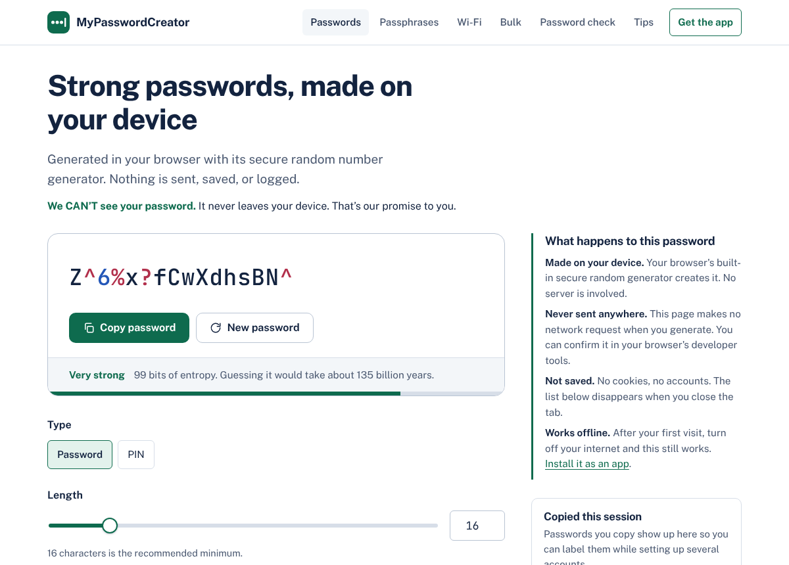

# MyPasswordCreator

**Free password tools that run entirely in your browser. No sign-up, no ads, no tracking.**

**Live site: [mypasswordcreator.com](https://mypasswordcreator.com)**



The code never sends your passwords anywhere, and this page explains how you can check that for yourself.

## What's on the site

- **Passwords and PINs.** Choose the length and character types. Every type you turn on appears at least once, and the strength shown is calculated exactly for your settings. PINs skip the ones people guess first (1234, 1212, birth years, keypad lines).
- **Safe for scripts, URLs and config files.** Limits symbols to `_` and `.`, so a password can go into a command line, PowerShell, a `mount` option, a connection string or a URL without quoting or escaping.
- **Picky sites.** Type exactly the symbols a site accepts, and only those are used.
- **Passphrases.** Random words from the EFF's 7,776-word list (or its 1,296-word short list).
- **Wi-Fi.** A strong Wi-Fi password and a printable guest card with a QR code that phones scan to join.
- **Bulk, for admins.** Up to 250 passwords or passphrases at once, matched to a list of usernames if you like, exported as CSV. Values that would start a spreadsheet formula are never produced.
- **Password check.** A private strength estimate as you type, plus a breach check against Have I Been Pwned.
- **Works offline.** After your first visit it keeps working with no connection, and it installs as an app.

## Why it exists

I wanted password tools I could hand to anyone, and use myself, without wondering where the password goes. If you already use a password manager, keep using its generator. This site covers what most of them don't: Wi-Fi guest cards, PINs that avoid the obvious ones, bulk batches for onboarding, script-safe passwords, and a strength and breach check that doesn't store or send what you type.

## How to check it yourself

You shouldn't have to take a website's word for this, so here's how to verify it.

1. **Watch the network.** Open your browser's developer tools (F12), go to the Network tab, and generate a few passwords. No requests are made.
2. **Read the policy the browser enforces.** The site's Content Security Policy is `default-src 'none'`. It allows the page's own files and exactly one outside address, `api.pwnedpasswords.com`, which the breach check uses. Your browser blocks everything else, including any script I might add by mistake. The policy is in [`public/_headers`](public/_headers).
3. **Compare the code.** The site's own JavaScript isn't minified or bundled, so what your browser runs is the same source you see here. The one exception is the vendored zxcvbn-ts strength library, which ships as a minified bundle and is listed in [THIRD-PARTY-NOTICES.md](THIRD-PARTY-NOTICES.md) with the command to rebuild it.
4. **Go offline.** Load the site once, turn off your connection, and keep using it.
5. **Run your own copy.** See "Run it yourself" below.

### What the breach check sends

The breach check sends only the first 5 characters of the password's SHA-1 hash to [Have I Been Pwned](https://haveibeenpwned.com/Passwords), never the password itself. This is HIBP's k-anonymity model: a 5-character prefix matches hundreds of other hashes, and the comparison against the results happens in your browser. Responses are padded so their size doesn't give the prefix away. HIBP does see your IP address, as any web service does.

### What this doesn't protect against

A website can change its code whenever it likes, and that includes this one. The checks above show what the site does when you look, not what it will do in the future. If that concerns you, install it and use it offline, or run it from your own clone. Like every host, Cloudflare sees normal request logs (IP address, page requested). There are no cookies, no analytics and no third-party scripts. Details: [mypasswordcreator.com/privacy](https://mypasswordcreator.com/privacy).

## How it's built

- Passwords come from `crypto.getRandomValues` with rejection sampling, so every character is equally likely (no modulo bias). `Math.random` isn't used anywhere.
- No framework, no runtime dependencies, no server code. It's a static site.
- Security logic lives in small, tested modules in [`src/core/`](src/core/): `random.js`, `generator.js`, `passphrase.js`, `pin.js`, `wifi.js`, `bulk.js`, `hibp.js`, `strength.js`.
- The strength estimate uses [zxcvbn-ts](https://github.com/zxcvbn-ts/zxcvbn), vendored and loaded only on the check page.

## Run it yourself

Requires Node 20 or newer. There's nothing to `npm install`.

```
git clone https://github.com/arcit-creator/mypasswordcreator.git
cd mypasswordcreator
npm test          # unit tests
npm run preview   # builds and serves at http://localhost:8788
```

## Security issues

Please report security issues privately. Instructions are in [SECURITY.md](SECURITY.md).

## License

Copyright (C) 2026 Reggie Cabasal. Free software under the [GNU AGPL v3.0 or later](LICENSE). If you run a modified version as a public website, the AGPL requires you to share your modified source with its users.

Third-party parts keep their own licenses (MIT QR library, MIT zxcvbn-ts, CC BY EFF word lists, OFL fonts). See [THIRD-PARTY-NOTICES.md](THIRD-PARTY-NOTICES.md).

The license covers the code, not the MyPasswordCreator name, logo or domain. Forks need their own name and branding.

Maintainer notes (build, deploy, site settings): [docs/MAINTAINING.md](docs/MAINTAINING.md).
